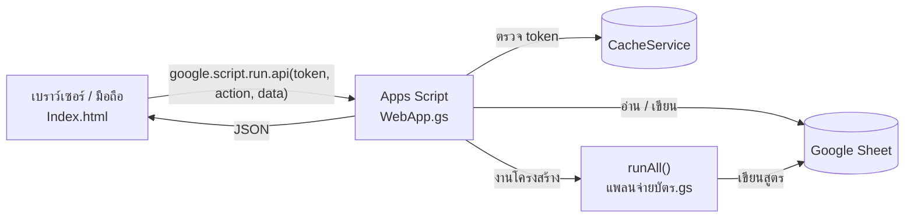

# 🏦 บัญชีบ้าน

เว็บแอปจัดการเงินในบ้าน สร้างด้วย **Google Apps Script** และใช้ **Google Sheet** เป็นฐานข้อมูล
รวมรายรับของ 2 คน ค่าผ่อนบัตรเครดิต ค่าใช้จ่ายประจำ ประกัน สวนปาล์ม และคอนโดให้เช่าไว้ในที่เดียว

## ความสามารถ

| หน้า | ทำอะไรได้ |
|---|---|
| 📊 ภาพรวม | การ์ดยอดเงินเหลือหลังจ่ายทุกอย่าง, สกอร์การ์ดรายรับ/รายจ่าย/ค่าผ่อน/อัตราเงินเหลือ, กราฟรายเดือน |
| 💰 รายรับ | กรอกรายรับและวันที่ได้เงินของแต่ละคน แก้ชื่อคนที่ 1 / คนที่ 2 ได้ |
| 🧾 รายจ่าย | ค่าบัตรอื่นๆ ของแต่ละคน และค่าใช้จ่ายประจำ (ค่าคอนโด ค่าบ้าน ค่าน้ำค่าไฟ) |
| 💳 ผ่อนบัตร | แพลนจ่ายรายเดือน ติ๊กจ่ายแล้ว, เพิ่ม/แก้/ลบรายการผ่อน (สูงสุด 24 งวด), การ์ดบัตรแยกธนาคาร, กรอกยอดจ่ายบัตรจริงเทียบยอดผ่อนว่าเกิน/ขาด |
| 🛡️ ประกัน | กรมธรรม์ที่ตัดบัตรเครดิต นับงวดที่จ่ายแล้วให้เอง และรวมเบี้ยเข้ายอดผ่อนของบัตรนั้น |
| 🌴 สวนปาล์ม | สมุดรายรับ-รายจ่าย กราฟแยกหมวด และการคืนทุนค่าที่ดิน |
| 🏙️ ปล่อยเช่าคอนโด | สมุดรายรับ-รายจ่าย และการคืนทุนค่าซื้อของเข้าห้อง |
| 👤 ผู้ใช้งาน | เพิ่มผู้ใช้ กำหนดสิทธิ์ viewer / editor / admin |

อื่นๆ: ล็อกอินแยกผู้ใช้, ซ่อนยอดเงินเป็นค่าเริ่มต้น (ปุ่ม 🙈/👁️), ธีมแอปธนาคารพร้อมภาพประกอบ, ใช้บนมือถือได้ (แถบเมนูด้านล่าง)

กติกาวันจ่าย: เงินเดือนเข้าวันที่ 29 (เดือนที่ไม่มีวันที่ 29 ใช้วันสุดท้ายของเดือน) ถ้าตรงเสาร์-อาทิตย์เลื่อนเป็นศุกร์ก่อนหน้า

## โครงสร้าง

```
src/
├── WebApp.gs          # API ของเว็บ: ล็อกอิน/เซสชัน, สิทธิ์, อ่าน-เขียนชีต, บัตร, ประกัน
├── แพลนจ่ายบัตร.gs     # สร้าง/ปรับโครงสร้างชีต (runAll), แพลนผ่อน, สมุดปาล์ม-คอนโด, ตั้งค่าต่างๆ
├── Index.html         # หน้าเว็บทั้งหมด (HTML + CSS + JS ในไฟล์เดียว)
└── appsscript.json    # manifest: timezone, V8, การตั้งค่า web app
docs/
└── index.html         # หน้า GitHub Pages ที่เปิดเว็บแอปเต็มจอ
```



### แท็บในชีต

| แท็บ | ใครเขียน | เก็บอะไร |
|---|---|---|
| แท็บรายการผ่อน (1 แท็บต่อ 1 รายการ) | เว็บ | วันที่ / ยอดต่องวด / บัตรที่ช่อง I1:I2 |
| แพลนจ่ายรายเดือน | runAll (สูตร) | รวมทุกรายการต่อเดือน + ช่องติ๊กจ่ายแล้ว |
| รายรับรายเดือน | เว็บ | รายรับ 2 คน + วันที่ได้เงิน |
| ค่าบัตรอื่นๆ · ค่าคอนโด · ค่าบ้าน · ค่าน้ำค่าไฟ | เว็บ | ยอดรายเดือน |
| ค่าตัดปาล์ม · ปล่อยเช่าคอนโด | เว็บ | สมุดรายรับ-รายจ่าย (A:E) + เงินลงทุน (M:O) |
| รายรับ-รายจ่าย | runAll (สูตร) | สรุปรายเดือน รายรับ − รายจ่าย = เหลือ |
| รายชื่อบัตร · ยอดจ่ายบัตรจริง | เว็บ | ข้อมูลบัตร และยอดที่จ่ายจริงต่อบัตรต่อเดือน |
| ประกัน | เว็บ | กรมธรรม์ (เบี้ย ความถี่ จำนวนงวด เดือนงวดแรก บัตรที่ตัด) |
| ผู้ใช้งาน (ซ่อน) | เว็บ | ชื่อผู้ใช้ + hash รหัสผ่าน (SHA-256 + salt) |

## ติดตั้ง

### วิธีที่ 1: คัดลอกเอง

1. เปิด Google Sheet → ส่วนขยาย → Apps Script
2. สร้างไฟล์ `WebApp.gs`, `แพลนจ่ายบัตร.gs` และไฟล์ HTML ชื่อ `Index` แล้ววางโค้ดจากโฟลเดอร์ `src/`
3. รันฟังก์ชัน `runAll` ครั้งแรก เพื่อสร้างแท็บและแพลน (อนุญาตสิทธิ์ตามที่ Google ถาม)
4. ทำให้ใช้งานได้ → การทำให้ใช้งานได้รายการใหม่ → ประเภท **เว็บแอป**
   - เรียกใช้ในฐานะ: **ฉัน**
   - ผู้ที่มีสิทธิ์เข้าถึง: **ทุกคน**
5. เปิดลิงก์เว็บ → สร้างบัญชีผู้ดูแลครั้งแรก

### วิธีที่ 2: ใช้ clasp

```bash
npm install -g @google/clasp
clasp login
cp .clasp.json.example .clasp.json   # แล้วใส่ Script ID ของโปรเจกต์
clasp push                            # ส่งไฟล์ใน src/ ขึ้น Apps Script
clasp deploy -i <DEPLOYMENT_ID>       # อัปเดตเว็บที่ deploy ไว้ให้เป็นเวอร์ชันใหม่ (ลิงก์เดิม)
```

> ⚠️ ทุกครั้งที่แก้โค้ด ต้อง deploy เป็น **เวอร์ชันใหม่** เว็บถึงจะเปลี่ยน
> (ทำให้ใช้งานได้ → จัดการ → ✏️ → เวอร์ชันใหม่ หรือ `clasp deploy -i <DEPLOYMENT_ID>`)

## เปิดผ่าน GitHub Pages (โดเมน github.io)

โฟลเดอร์ `docs/` เป็นหน้าห่อเว็บแอป เปิด Apps Script เต็มจอภายใต้ลิงก์ `https://<ชื่อผู้ใช้>.github.io/<ชื่อ repo>/`

1. แก้ `APP_URL` ใน `docs/index.html` ให้เป็นลิงก์ `/exec` ของเว็บแอป
2. `WebApp.gs` ต้องมี `.setXFrameOptionsMode(HtmlService.XFrameOptionsMode.ALLOWALL)` ใน `doGet()` (มีแล้ว) และ deploy เป็นเวอร์ชันใหม่
3. GitHub → Settings → Pages → Source: **Deploy from a branch** → Branch: `main` / โฟลเดอร์ `/docs` → Save
4. รอ 1–2 นาที แล้วเปิดลิงก์ที่ GitHub แสดง

โดเมนของตัวเอง (ถ้ามี): ใส่ชื่อโดเมนที่ Settings → Pages → Custom domain แล้วตั้ง DNS เป็น CNAME ชี้ไปที่ `<ชื่อผู้ใช้>.github.io`

> GitHub Pages ฟรีใช้ได้กับ repo แบบ **Public** เท่านั้น (Private ต้องใช้ GitHub Pro)
> ถ้าไม่อยากเปิดโค้ดให้คนอื่นเห็น ให้แยก repo: โค้ดเก็บใน repo Private และเอาแค่ `docs/index.html` ไปไว้ใน repo Public อีกอัน

## ปรับค่าตั้งต้น

| ค่า | อยู่ที่ |
|---|---|
| ค่าใช้จ่ายประจำ (ชื่อ / ยอดตั้งต้น) | `FIXED_SHEETS` ใน `แพลนจ่ายบัตร.gs` |
| สมุดปาล์ม-คอนโด หมวด และเงินลงทุนตั้งต้น | `LEDGERS` ใน `แพลนจ่ายบัตร.gs` |
| จำนวนเดือนล่วงหน้า | `HORIZON_MONTHS`, `HORIZON_MIN_LEFT` |
| บัตรตั้งต้น | `DEFAULT_CARDS` ใน `WebApp.gs` |
| กรมธรรม์ตั้งต้น | `DEFAULT_INS` ใน `WebApp.gs` (ตั้งเป็น `null` ถ้าไม่ต้องการ) |

## ความปลอดภัย

- เว็บรันในนามเจ้าของสคริปต์ คนที่ใช้เว็บไม่ต้องมีสิทธิ์เข้าชีต ระบบล็อกอินของเว็บเป็นด่านเดียว
- รหัสผ่านเก็บเป็น hash + salt ใส่ผิด 5 ครั้งล็อก 15 นาที เซสชันอยู่ได้ 6 ชั่วโมง
- งานเขียนทุกอย่างถือ `LockService` กันเขียนทับกัน
- ไฟล์ `.clasp.json` (มี Script ID) ไม่ขึ้น GitHub ตาม `.gitignore`
